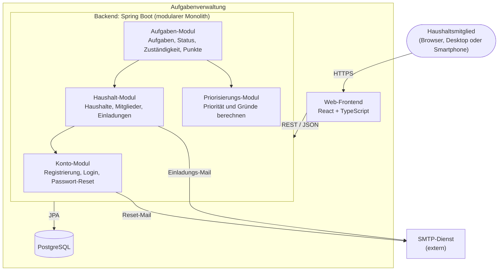
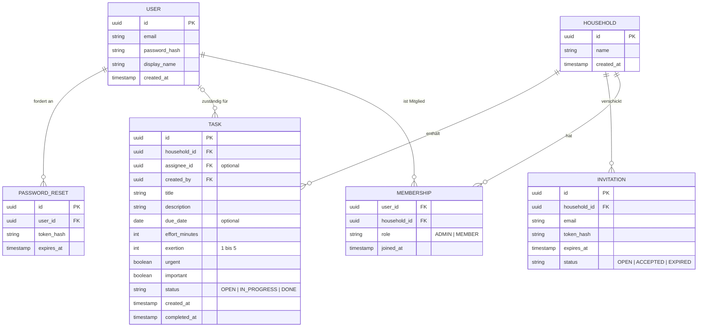

# Architektur: Aufgabenverwaltung mit automatischer Priorisierung

Dieses Dokument beschreibt die Architektur für den MVP aus [`requirements.md`](requirements.md).

## 1. Überblick

Die Anwendung ist eine **responsive Web-App** (Desktop und Smartphone) mit einem **Spring-Boot-Backend als modularem Monolithen** und einer **PostgreSQL-Datenbank**. Das Frontend spricht über eine REST-API mit dem Backend. Die Priorität einer Aufgabe wird bei jeder Abfrage berechnet und nicht gespeichert.

## 2. Architekturvarianten

| Kriterium | A: Modularer Monolith | B: Microservices |
| --- | --- | --- |
| Aufbau | Ein Backend mit Modulen (Konto, Haushalt, Aufgaben, Priorisierung), eine Datenbank | Eigener Service pro Bereich, API-Gateway, Message Queue für Neuberechnungen |
| Entwicklungsaufwand | Gering, ein Projekt, ein Build | Hoch, mehrere Projekte, Service-Kommunikation |
| Betrieb und Kosten | Ein Container + eine Datenbank | Mehrere Container, Gateway, Broker |
| Performance (< 100 ms) | Gut, Aufrufe innerhalb des Prozesses | Schlechter, Netzwerkaufrufe zwischen Services |
| Skalierbarkeit | Ausreichend für Haushalte (wenige Nutzer pro Haushalt) | Sehr hoch, wird für den MVP nicht benötigt |
| Passt zum Team und Semester | Ja | Nein, zu viel Infrastruktur |

**Entscheidung: Variante A.** Sie erfüllt alle MVP-Anforderungen mit deutlich weniger Aufwand. Durch klare Module kann später ein Teil ausgelagert werden, falls nötig. Details: [ADR-0001](adr/0001-modularer-monolith.md).

## 3. Technologieauswahl

| Bereich | Technologie | Begründung |
| --- | --- | --- |
| Backend | Java 21, Spring Boot 3 | Im Team aus dem Studium bekannt; Spring Security deckt Login, Passwort-Reset und Zugriffsschutz ab (NFA-04) |
| Frontend | React mit TypeScript (Vite) | Responsive Oberfläche für Desktop und Smartphone (NFA-02), ohne eigene Mobile-App |
| Datenbank | PostgreSQL | Relationale Daten (Haushalte, Mitglieder, Aufgaben); zuverlässige Speicherung über mindestens 1 Jahr (NFA-03) |
| Datenzugriff | Spring Data JPA, Flyway | Weniger Boilerplate; Datenbankschema versioniert im Repo |
| Authentifizierung | Session-Cookie (HttpOnly) über Spring Security | Einfacher und sicherer als selbst verwaltete Tokens, da Frontend und Backend unter einer Domain laufen |
| E-Mail | SMTP-Dienst | Für Einladungen und Passwort-Reset |
| Auslieferung | Ein Docker-Image (Backend liefert auch das gebaute Frontend aus) | Ein Deployment, einfaches Hosting |

## 4. Architekturdiagramm

Containerdiagramm nach C4 (Ebene 2), inklusive der Module im Backend:



| Modul | Verantwortung |
| --- | --- |
| Konto | Benutzerkonten, Login/Logout, Passwort zurücksetzen |
| Haushalt | Haushalte anlegen, bearbeiten, löschen; Mitglieder einladen; Austritt (offene Aufgaben werden freigegeben) |
| Aufgaben | Aufgaben anlegen, bearbeiten, löschen; Status, Zuständigkeit, Punkte; Filter und Sortierung |
| Priorisierung | Berechnet aus Wichtigkeit, Dringlichkeit, Fälligkeit und Überfälligkeit eine Priorität samt Begründung |

## 5. Datenmodell



**Abgeleitete Werte werden nicht gespeichert:** Punkte (aus Aufwand und Anstrengung), Zeitkategorie (30 / 60 / 60+ min aus `effort_minutes`) und Priorität werden bei der Abfrage berechnet.

## 6. API-Design

REST, JSON, alle Pfade unter `/api`. Jeder Zugriff auf einen Haushalt prüft die Mitgliedschaft.

| Methode | Pfad | Zweck |
| --- | --- | --- |
| POST | `/auth/register` | Konto anlegen |
| POST | `/auth/login` · `/auth/logout` | Anmelden · Abmelden |
| POST | `/auth/password-reset` · `/auth/password-reset/confirm` | Reset anfordern · neues Passwort setzen |
| POST | `/households` | Haushalt erstellen |
| GET · PATCH · DELETE | `/households/{id}` | Haushalt anzeigen · umbenennen · löschen |
| POST | `/households/{id}/invitations` | Mitglied einladen |
| POST | `/invitations/{token}/accept` | Einladung annehmen |
| DELETE | `/households/{id}/members/me` | Haushalt verlassen (offene Aufgaben werden freigegeben) |
| GET | `/households/{id}/tasks?status=&assignee=&sort=priority` | Haushaltsaufgaben, gefiltert und sortiert |
| POST | `/households/{id}/tasks` | Aufgabe erstellen |
| GET · PATCH · DELETE | `/tasks/{id}` | Aufgabe anzeigen · bearbeiten · löschen |
| POST | `/tasks/{id}/claim` | Aufgabe freiwillig übernehmen |
| PUT | `/tasks/{id}/assignee` | Aufgabe zuweisen |
| POST | `/tasks/{id}/complete` · `/tasks/{id}/reopen` | Erledigung bestätigen · wieder öffnen |
| GET | `/me/tasks` | Persönliche Aufgabenliste |

Beispiel-Antwort einer Aufgabe:

```json
{
  "id": "3f6c...",
  "title": "Bad putzen",
  "dueDate": "2026-11-24",
  "effortMinutes": 45,
  "exertion": 3,
  "urgent": true,
  "important": false,
  "status": "OPEN",
  "assignee": { "id": "a12b...", "displayName": "Raul" },
  "points": 9,
  "priority": { "score": 78, "reasons": ["Fällig morgen", "Dringend"] }
}
```

Fehler werden mit passendem HTTP-Status (400, 401, 403, 404, 409) und dem Format `{ "error": "TASK_NOT_FOUND", "message": "..." }` zurückgegeben.

## 7. AI-Einsatz

AI (Claude) wurde genutzt, um Varianten vorzuschlagen, Schwachstellen zu finden und Vorschläge zu prüfen.

| AI-Beitrag | Bewertung durch das Team | Ergebnis |
| --- | --- | --- |
| Vorschlag Microservices mit Message Queue für die Neuberechnung der Prioritäten | Zu komplex für Semester und Teamgröße; Netzwerkaufrufe erschweren das 100-ms-Ziel | Abgelehnt, modularer Monolith gewählt ([ADR-0001](adr/0001-modularer-monolith.md)) |
| Priorität speichern und per zeitgesteuertem Job regelmäßig neu berechnen | Werte veralten zwischen zwei Läufen; zusätzlicher Job nötig. Bei wenigen Aufgaben pro Haushalt ist die Berechnung bei der Abfrage schnell genug | Abgelehnt, Berechnung zur Abfragezeit ([ADR-0002](adr/0002-prioritaet-zur-abfragezeit.md)) |
| JWT mit Refresh-Tokens für die Anmeldung | Mehr Aufwand und Fehlerquellen (Speicherung, Widerruf), kein Vorteil bei einer Domain | Abgelehnt, Session-Cookie |
| Risiko: gleichzeitiges Bearbeiten derselben Aufgabe | Berechtigt | Optimistic Locking (Versionsfeld) bei Bedarf in V2 |
| Risiko: Missbrauch von Einladungs- und Reset-Links | Berechtigt | Tokens nur als Hash speichern, mit Ablaufzeit |
